# Lumora — AI agent, CRM and help desk

> Lumora answers your team's questions from company documents with **citations**, runs the **support inbox and sales pipeline** in an AI-native CRM, and lets AI agents **act on that data** through tool calls, a REST API and an **MCP server**. Admins manage the team with roles, "view as", automations and an audit log.

[](https://github.com/itx-Champion/lumora/actions/workflows/ci.yml)

**Live demo:** [lumora-ai-agent.vercel.app](https://lumora-ai-agent.vercel.app) · **Stack:** Next.js 16 · React 19 · TypeScript · Postgres (Neon) · Drizzle ORM · Vercel AI SDK 7 · Gemini / Groq · MCP · Auth.js · Tailwind CSS 4 · Three.js


Lumora is a portfolio product I designed and engineered end to end: brand, marketing site, 3D hero, authentication, a retrieval-augmented agent, a multi-tenant CRM with team administration, a REST API and an MCP server. Company names, people and testimonials in the demo are fictional.

---

## What is Lumora?

Support and sales teams juggle three things: knowledge buried in documents, customers spread across a CRM, and a queue of tickets with deadlines. Lumora puts all three behind one AI agent.

1. **Ask your documents.** Upload PDFs, Markdown, CSV or JSON, or import a web page. Ask in plain language, typed or spoken, and every claim in the answer links to the exact passage it came from. If the documents don't cover it, Lumora says so.
2. **Run the help desk.** Tickets arrive from email, chat, the API or the agent. Each one is **triaged automatically** (priority, team, tags), timed against an **SLA**, routed by **automations**, and answered with **AI-drafted replies grounded in your knowledge base**.
3. **Work the pipeline.** Drag deals across a Kanban board with a weighted forecast. Contacts get an **explainable AI lead score** ("+20 decision-maker title, +12 referral, −5 quiet for 16 days"), accounts get a **health score**, and every touchpoint lands on a timeline.
4. **Let the agent do the follow-up.** *"Move the Zephyr deal to won"*, *"Which urgent tickets are open?"*, *"Who is Maya Okafor? Remind me to call her tomorrow."* The agent calls CRM tools with your permissions, and automations fire just as if you'd clicked the button.
5. **Start the day with Pulse.** A home screen that watches SLA breaches, stalled deals, hot leads and at-risk accounts, plus an **AI briefing** that turns them into a plan.
6. **Administer the team.** Invite people, assign one of five roles, suspend access, **view the app as any teammate**, build no-code automations, issue scoped API keys and read an append-only **audit log**.
7. **Plug in any AI client.** The built-in **MCP server** lets Claude, Cursor or ChatGPT search and update the CRM with an API key, under the same rules and audit trail as the app.

## Try the demo in 2 minutes

1. Open **[lumora-ai-agent.vercel.app](https://lumora-ai-agent.vercel.app)** → **Try the live demo** → **Enter demo workspace**. You become the **owner of a private sandbox** with a 10-person team, 30 companies, ~90 contacts, ~40 deals and ~50 tickets. Nothing you change is visible to anyone else.
2. **Pulse:** click **Generate** on *Your AI briefing*.
3. **Inbox:** open a ticket and click **Draft with AI**. The reply cites your knowledge base.
4. **Deals:** drag a card to **Won**. The contact becomes a customer and an onboarding task appears (automation).
5. **Assistant:** ask *"Summarize our pipeline and the biggest open deals"*.
6. **Team:** open the ⋯ menu on *Omar Farooq* → **View app as Omar**. The admin pages disappear because agents can't see them. Click **Stop viewing**.
7. **API & MCP:** create a key and connect Claude with the snippet shown, or call `GET /api/v1/pipeline`.

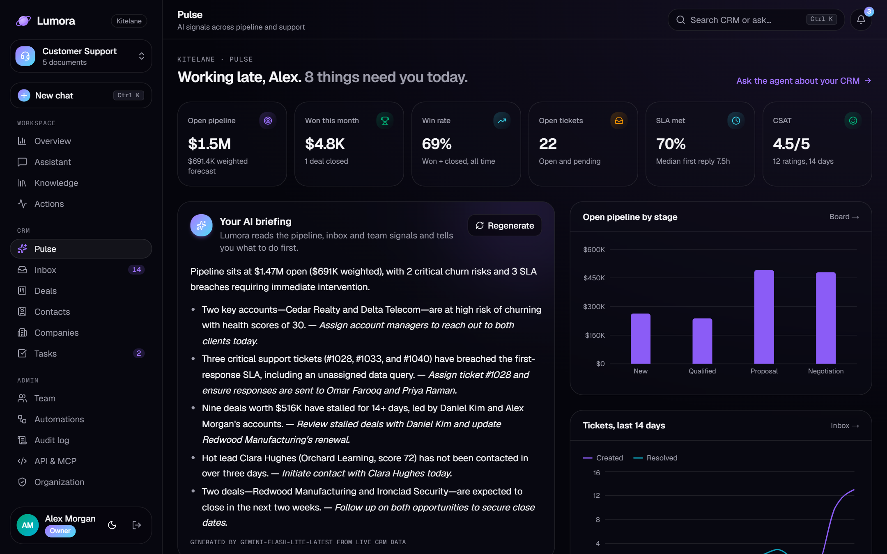

---

## Highlights

| | |
|---|---|
| **Multi-tenant Postgres CRM** | Contacts, companies, deals, tickets with threaded messages, tasks, activity timelines, notifications, automations, API keys and audit logs in 13 Drizzle tables. Every query is scoped by `org_id`; an integration test proves one organization can't read another's data. |
| **Private sandbox per visitor** | First sign-in provisions an organization in one transaction and seeds a realistic, deterministic dataset with dates relative to *now*. A daily Vercel Cron removes sandboxes idle for a week. Owners can reset their sandbox at any time. |
| **RBAC enforced on the server** | Five roles (owner, admin, manager, agent, viewer) and 11 permissions in one table. Every server action, API route, MCP tool and AI tool checks it. Rules prevent removing the last owner, granting a role above your own or admins editing other admins. |
| **"View as" impersonation** | Admins can see the app exactly as a teammate does. A banner shows the session, and every change made during it is logged as that member *with the admin recorded alongside*. |
| **AI inside the workflow** | Morning briefing, pre-call contact briefs, ticket replies grounded in the knowledge base, auto-triage, explainable lead scores and account health. Each AI feature has a deterministic fallback, so the demo works with no API key. |
| **Agent tools on real data** | `searchCrm`, `pipelineSummary`, `listOpenTickets`, `updateDealStage`, `createTask`, plus `createTicket`, `draftEmail` and `scheduleMeeting` that now write to the CRM. Tools call the same service layer as the UI, so permissions, audit and automations apply. |
| **MCP server + REST API** | Streamable HTTP MCP server (`mcp-handler`, MCP SDK v2) with 8 tools and RFC 9728 auth challenges. REST v1 with Bearer keys, per-key rate limits and RFC 9457 problem responses. Keys are shown once and stored as SHA-256 hashes, with `crm:read` / `crm:write` scopes. |
| **No-code automations** | "When → if → then" rules (ticket created, deal stage changed, contact created) with conditions and actions such as assign, load-balanced round-robin, set priority, tag, create task and notify. |
| **Help desk with SLAs** | Per-priority first-response targets, live SLA states (on track, at risk, breached, met), internal notes, CSAT, round-robin assignment, and "send & resolve". |
| **Pipeline board** | dnd-kit Kanban with keyboard support, fractional ordering (one write per move), stage probabilities, weighted forecast, stalled-deal flags and a lost-reason prompt. |
| **RAG with real citations** | Section-aware chunking and Okapi BM25 with query expansion and a minimum-should-match rule. Every claim links to its passage. |
| **Provider fallback chain** | Gemini → Groq → keyless mode. Each stream is probed for its first token, so quota errors and slow models fall through invisibly. |
| **Tested and CI-checked** | 60 Vitest tests, including integration tests that run migrations and business flows on a **real Postgres** (PGlite, in process). GitHub Actions runs lint, type-check, tests and a production build on every push. |
| **Production details** | Next.js 16 Cache Components with Partial Prerendering and streaming skeletons, zod everywhere, SQL migrations on deploy, CSV import/export with formula-injection protection, SSRF-safe web import, security headers, dark and light themes. |

## Screenshots

### CRM and help desk

| Inbox with AI-drafted, knowledge-grounded reply | Pipeline board |
|---|---|
| 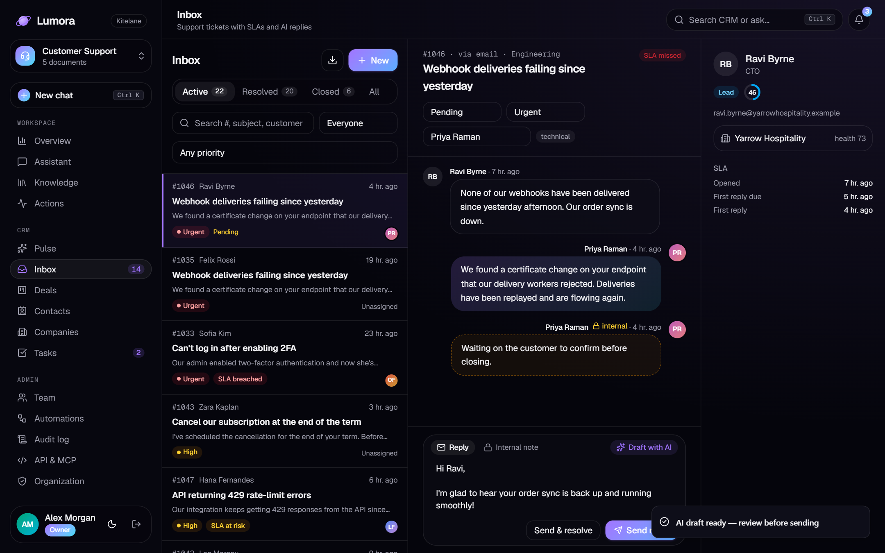 | 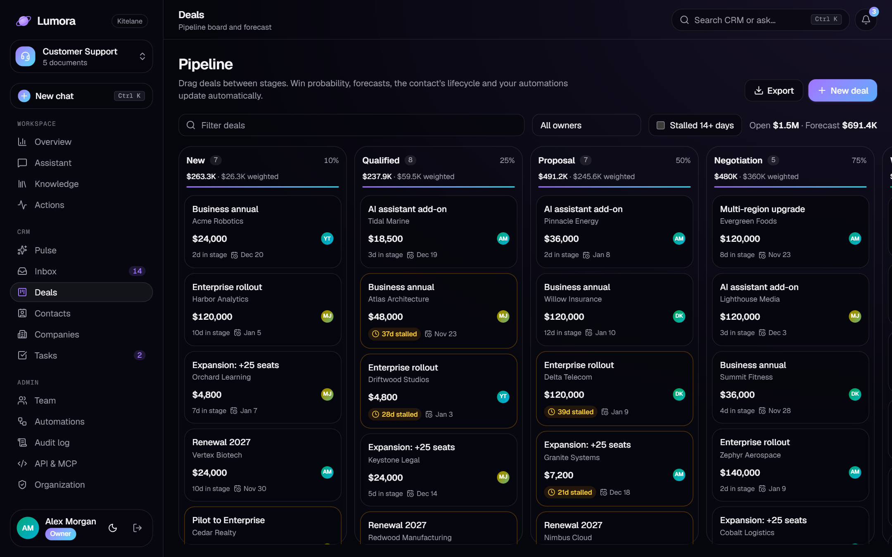 |
| **Contact with AI brief, lead score reasons and timeline** | **Contacts with bulk actions** |
| 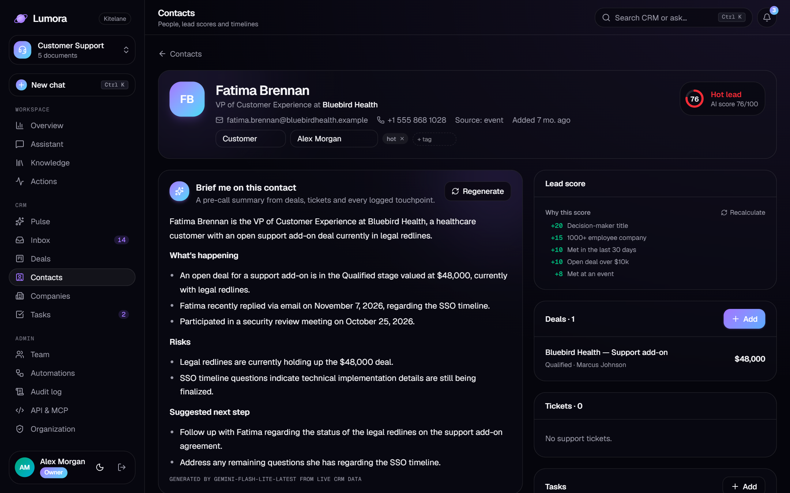 | 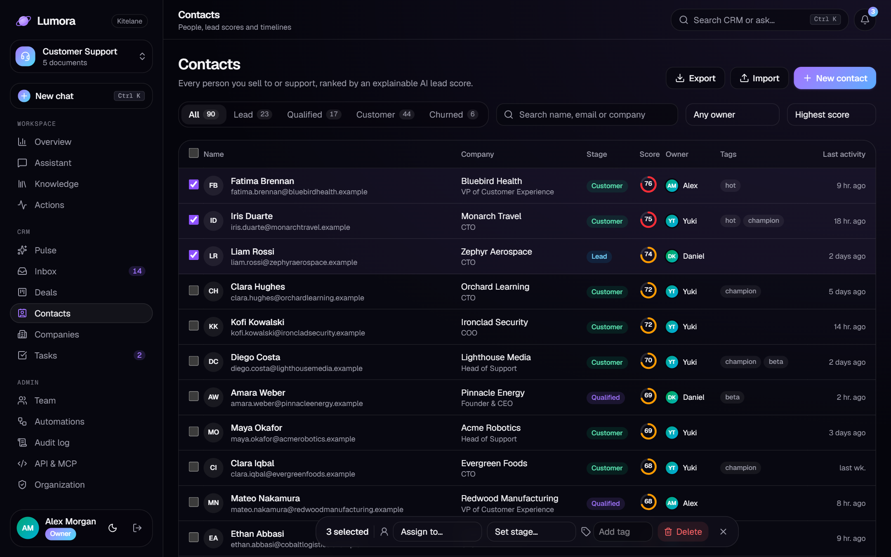 |
| **Agent acting on the CRM** | **Accounts with health scores** |
| 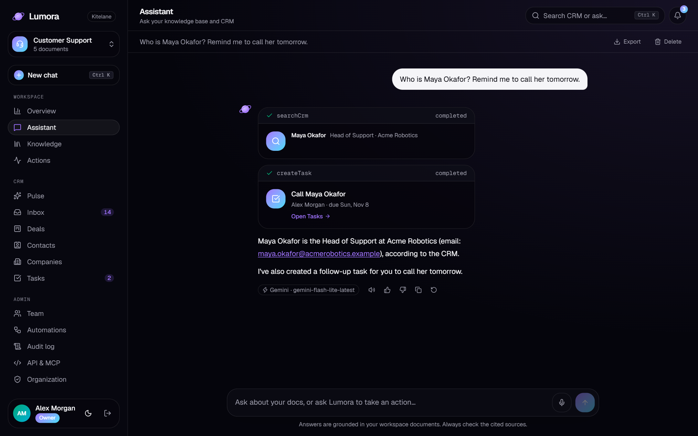 | 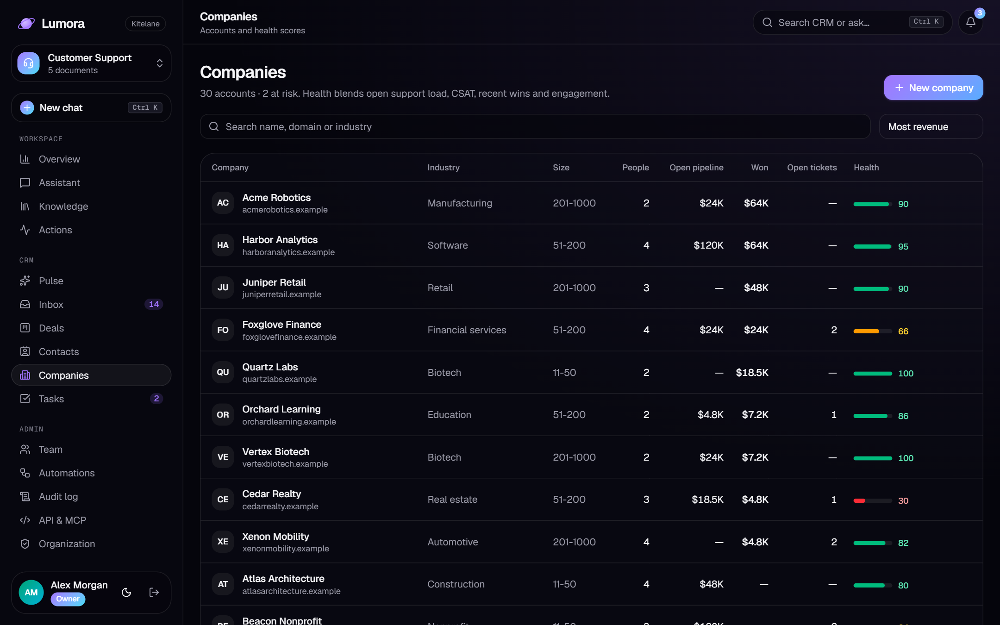 |

### Administration

| Team, roles and permissions | Viewing the app as an agent |
|---|---|
| 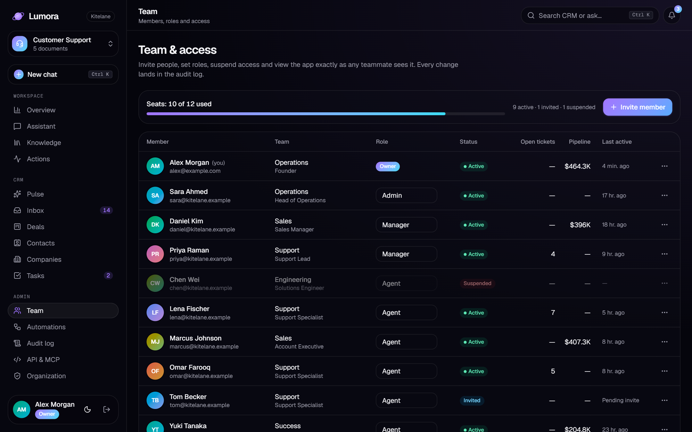 | 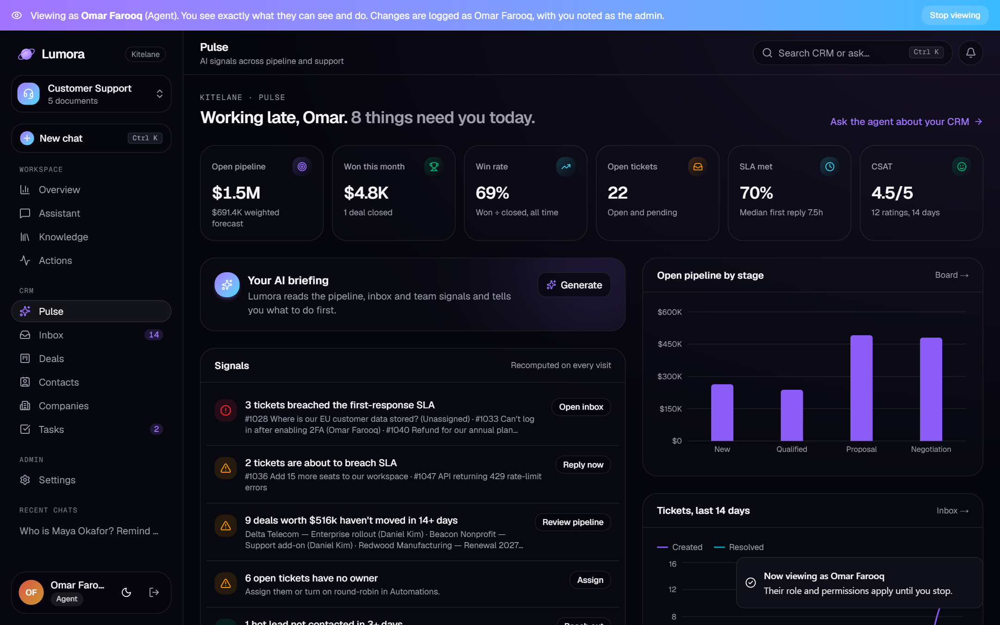 |
| **No-code automations** | **API keys and MCP server** |
| 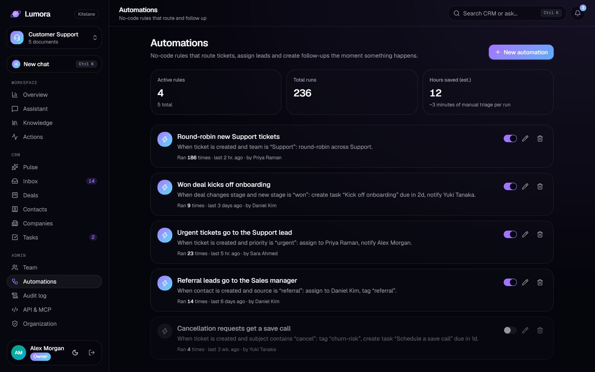 | 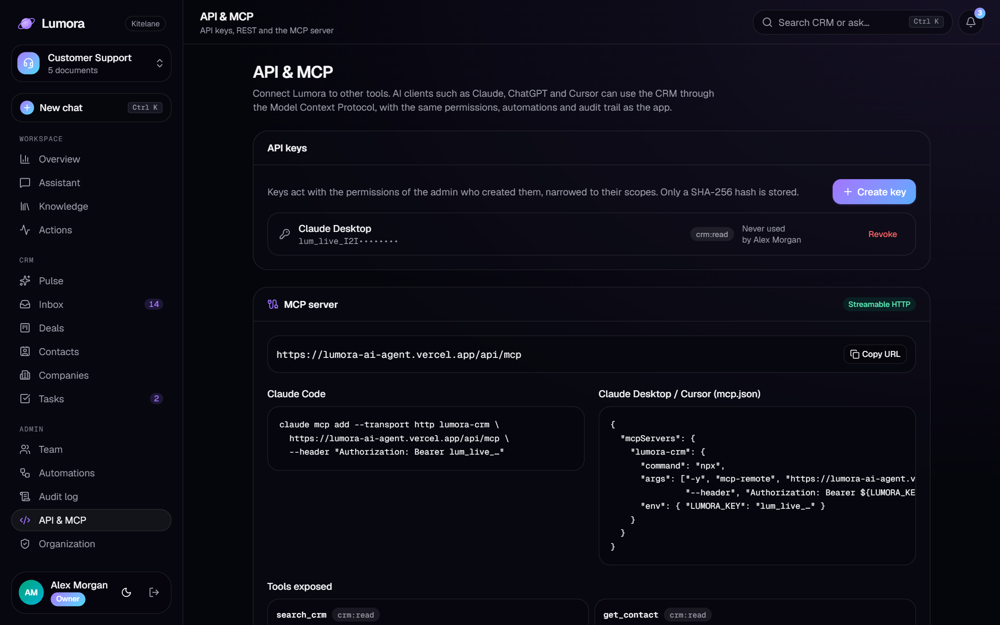 |
| **Audit log** | **Organization settings** |
| 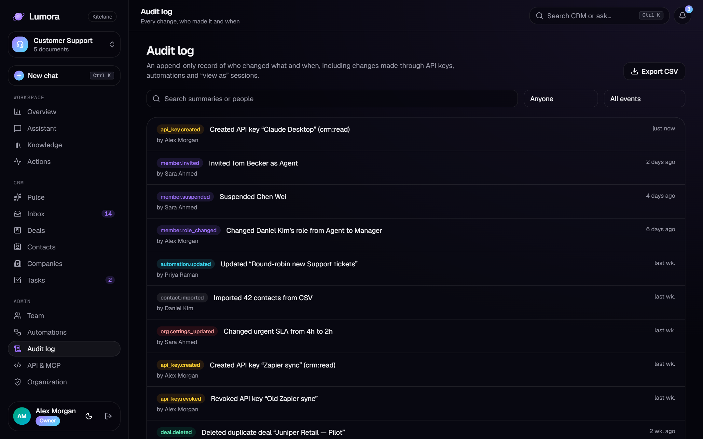 | 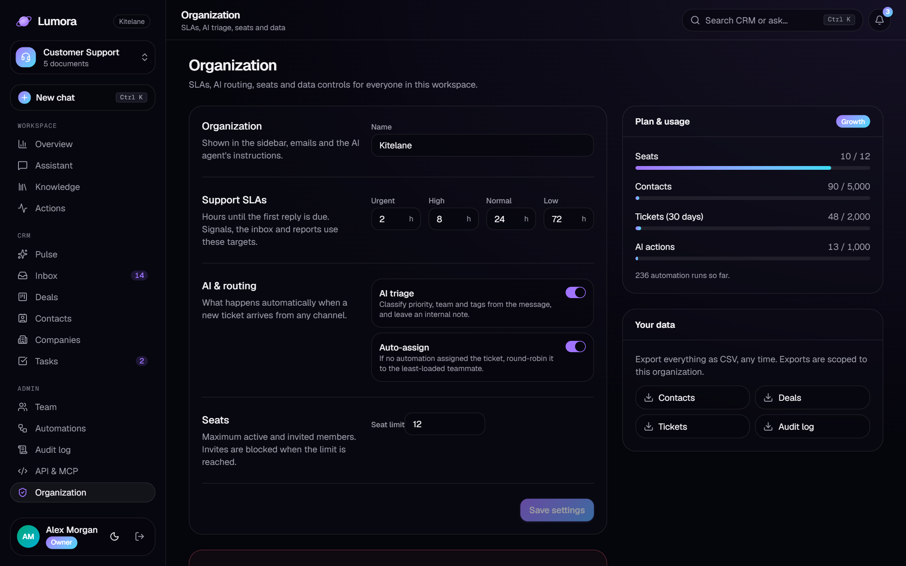 |

### Knowledge assistant and marketing site

| Assistant with citations | Knowledge base and retrieval playground |
|---|---|
|  |  |
| **Features (bento grid)** | **Light theme** |
|  |  |

## Architecture

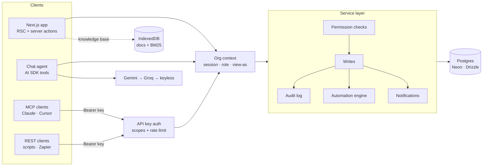

**One path for every write.** The UI (server actions), the AI agent's tools, the REST API and the MCP server all call the same functions in `lib/crm/services.ts`. That's where permissions are checked, automations run, notifications go out and audit entries are written, so a ticket created by Claude over MCP behaves exactly like one created in the inbox.

**Request lifecycle for a ticket**

1. The entry point resolves an org context: a session (with optional "view as") or an API key, narrowed by its scopes.
2. `createTicketRecord` triages the text (priority, team, tags), sets the SLA due time, matches or creates the contact, and writes the ticket and its first message.
3. Matching automations run in order (assign, round-robin by open load, tag, task, notify), followed by auto-assign if nobody owns it yet.
4. An audit entry records who did it and how ("via API key *Zapier sync*", "Priya Raman, with Alex Morgan viewing as her").

## Project structure

```
src/
├─ app/
│  ├─ app/
│  │  ├─ crm/                  # Pulse, inbox, deals, contacts, companies, tasks
│  │  ├─ admin/                # Team, automations, audit log, API & MCP, organization
│  │  ├─ profile/              # Personal settings
│  │  └─ chat, knowledge, …    # Knowledge assistant
│  └─ api/
│     ├─ chat/                 # Streaming agent with CRM tools
│     ├─ mcp/                  # MCP server (8 tools)
│     ├─ v1/                   # REST API
│     ├─ crm/ai, crm/export    # AI briefings and drafts, CSV export
│     └─ cron/cleanup          # Daily sandbox cleanup
├─ db/                         # Drizzle schema and client (Neon in prod, PGlite locally)
├─ lib/
│  ├─ crm/                     # context, services, queries, permissions, scoring,
│  │                           # automation engine, seed, API keys, server actions, tests
│  ├─ ai/                      # tools, prompt, provider chain, keyless responder
│  ├─ rag/                     # chunking, BM25, tests
│  └─ web/                     # SSRF-safe fetcher, tests
├─ components/crm/             # Tables, board, inbox thread, builders, dialogs
drizzle/                       # SQL migrations
```

## Run locally

```bash
npm install
cp .env.example .env.local      # set AUTH_SECRET (npx auth secret)
npm run dev                     # http://localhost:3000
npm test                        # unit + Postgres integration tests
```

No database setup is needed locally: without `DATABASE_URL`, Lumora runs an embedded Postgres (PGlite) in `.data/` and applies the migrations on first use. In production, set `DATABASE_URL` to Neon (or any Postgres) and migrations run before each build.

| Variable | Purpose |
|---|---|
| `AUTH_SECRET` | Signs session cookies (**required**) |
| `DATABASE_URL` | Postgres connection string (Neon in production; optional locally) |
| `GOOGLE_GENERATIVE_AI_API_KEY` | Gemini, the primary model ([free key](https://aistudio.google.com/apikey)) |
| `GROQ_API_KEY` | Llama via Groq, the fallback |
| `CRON_SECRET` | Authorizes the daily sandbox cleanup |
| `AUTH_GITHUB_ID` / `AUTH_GITHUB_SECRET` | Optional GitHub login |
| `UPSTASH_REDIS_REST_URL` / `_TOKEN` | Rate limits shared across serverless instances |

Database scripts: `npm run db:generate` (new migration from the schema), `npm run db:migrate`, `npm run db:studio`.

## Design decisions

- **A sandbox per visitor instead of a shared demo.** Anyone can be an admin and delete things without spoiling the demo for others. Identity is a per-browser id, so even visitors who keep the default email get separate organizations.
- **Service layer over "fat" route handlers.** Four entry points (UI, agent, REST, MCP) share one implementation of each business operation, so behaviour and authorization can't drift apart.
- **Explainable scores.** Lead and health scores are rule-based with a reason for every point. Reps trust a score they can read, and the AI uses the same reasons in its briefings.
- **Postgres everywhere.** Production uses Neon over WebSockets (interactive transactions). Development and tests use PGlite, a real Postgres compiled to WASM, so tests exercise the actual SQL and migrations.
- **Knowledge stays in the browser.** Documents and retrieval run client-side (IndexedDB + BM25), keeping uploads private to the visitor. The CRM is server-side because a team has to share it.

## Roadmap

- Hybrid retrieval (BM25 + embeddings in pgvector) and team-shared knowledge bases
- Real channels: inbound email parsing, Slack and WhatsApp
- OAuth 2.1 for the MCP server (client ID metadata documents) next to API keys
- Evaluation harness for answer faithfulness and triage accuracy

---

Built by **Ahmad Sharif**, AI Engineer & Full-Stack Developer. [GitHub](https://github.com/itx-Champion)
