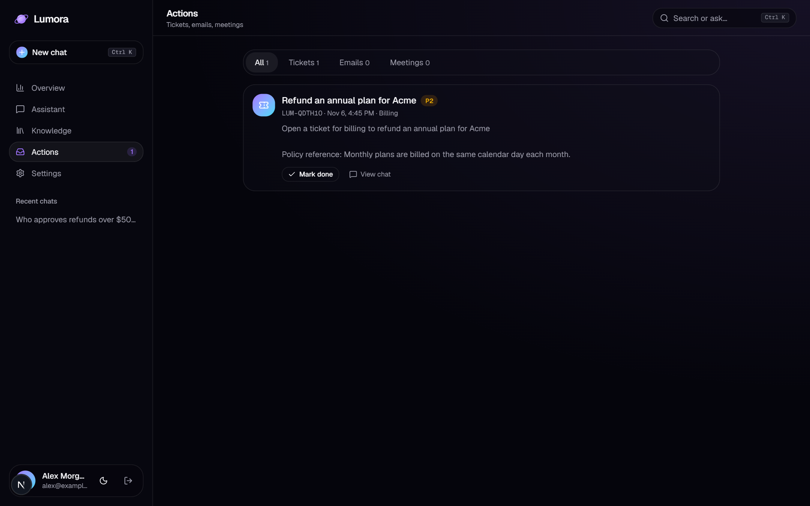
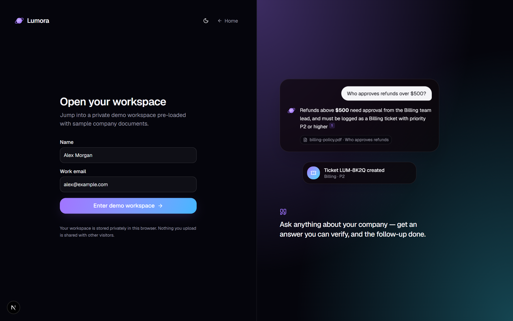
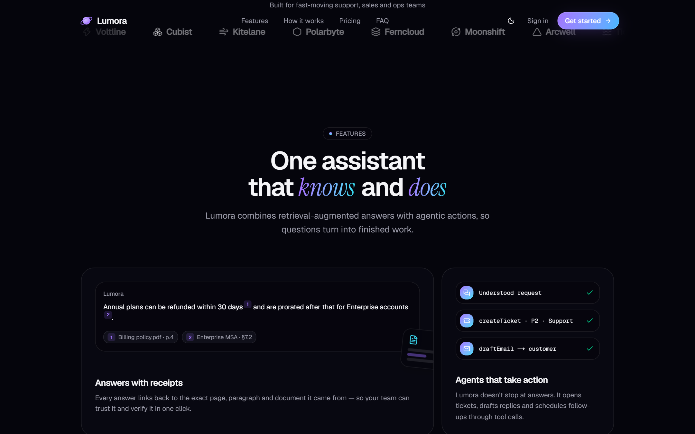
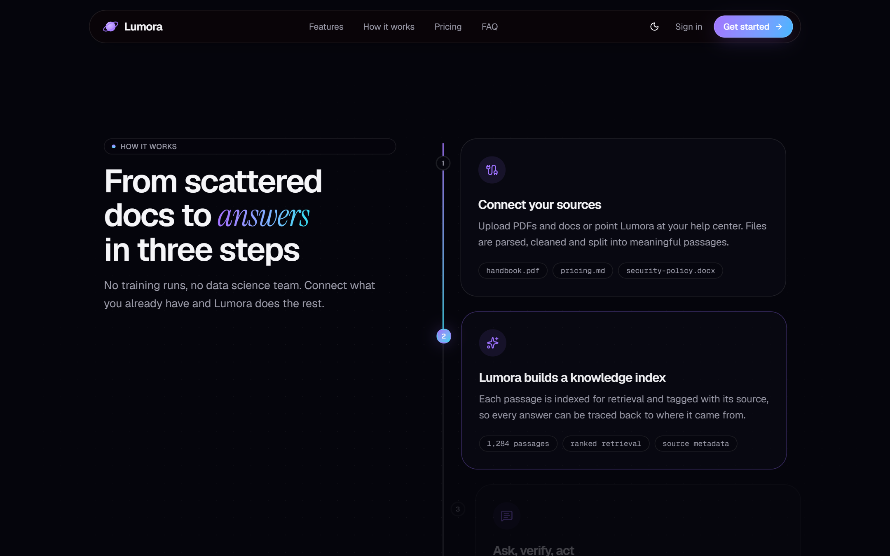
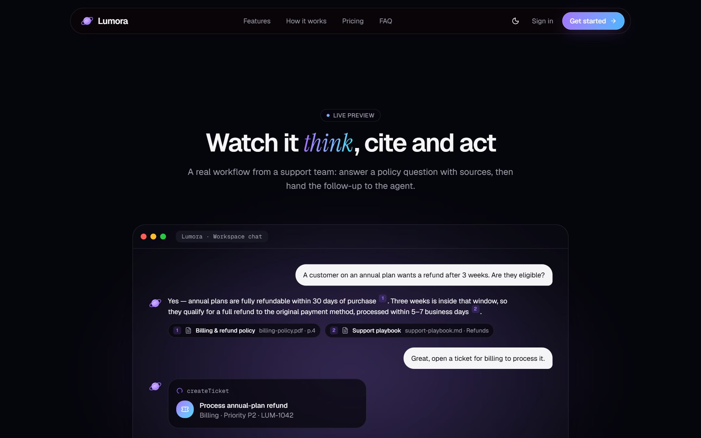
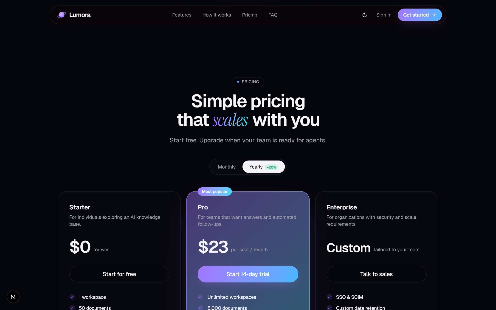
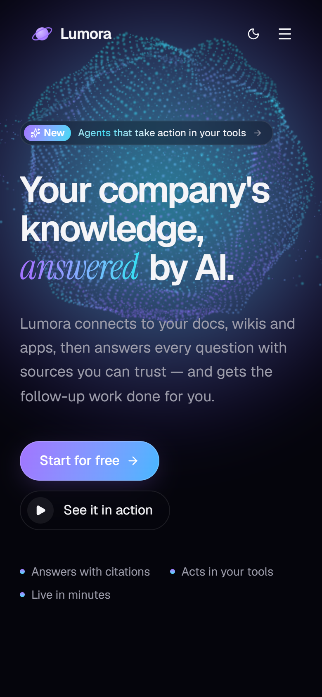
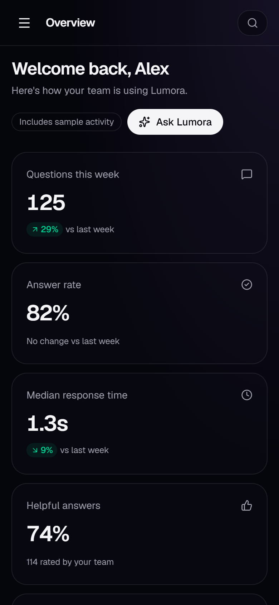
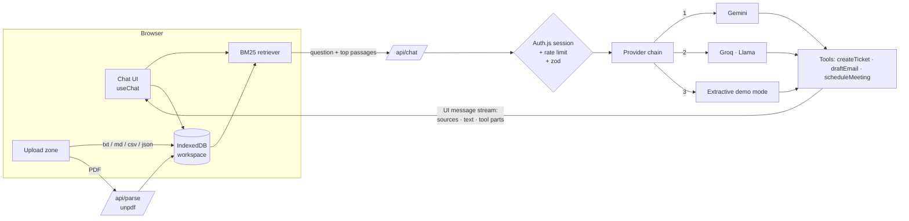

# Lumora — AI Knowledge Agent

> Your company's knowledge, answered by AI. Lumora turns documents into an assistant that answers with **citations** and takes **actions** (tickets, emails, meetings) through tool calls.

[](https://github.com/itx-Champion/lumora/actions/workflows/ci.yml)

**Live demo:** [lumora-ai-agent.vercel.app](https://lumora-ai-agent.vercel.app) · **Stack:** Next.js 16 · React 19 · TypeScript · Tailwind CSS 4 · Three.js · Vercel AI SDK 7 · Gemini / Groq · Auth.js


Lumora is a portfolio product I designed and engineered end to end: brand, marketing site, 3D hero, authentication, a retrieval-augmented chat agent, document ingestion, an actions inbox and an analytics dashboard. Company names and testimonials in the demo are fictional.

---

## What is Lumora?

Every company has answers buried in documents: HR policies, refund rules, security guidelines, reports. Finding the right paragraph takes time, so people ask colleagues instead.

Lumora fixes that:

1. **Add your knowledge.** Upload PDFs, Markdown, text, CSV or JSON, or paste a website link. Lumora splits everything into searchable passages.
2. **Ask in plain language, typed or spoken.** For example: *"Can a customer get a refund after 3 weeks?"* Answers can be read aloud.
3. **Get an answer you can verify.** Every claim carries a numbered citation. Click it to see the exact passage. If the documents don't cover the question, Lumora says so instead of guessing.
4. **Hand off the follow-up.** Say *"Open a ticket for billing"*, *"Draft an email to the customer"* or *"Schedule a meeting with support"*, and the agent does it. Results appear in the Actions inbox.
5. **See what your team needs.** The dashboard tracks questions, answer rate, response time and 👍/👎 feedback, plus the **knowledge gaps**: questions your documents couldn't answer.
6. **One workspace per team.** Start from a template (Customer Support, HR & People Ops, Legal & Compliance) or a blank workspace.

## Try the demo in 60 seconds

1. Open **[lumora-ai-agent.vercel.app](https://lumora-ai-agent.vercel.app)**, then click **Try the live demo**, then **Enter demo workspace**. No sign-up needed; the workspace stays private to your browser.
2. Go to **Assistant** and pick a suggested question, or ask: *"Who approves refunds over $500?"*
3. Click a citation number such as **[1]** to read the source passage.
4. Ask: *"Open a ticket for billing to process the refund"*, then check **Actions**.
5. In **Knowledge**, upload a PDF or import a web page, then ask about it. The **Retrieval playground** shows which passages the AI receives, with relevance scores.
6. Open the workspace switcher (top left), create an **HR & People Ops** workspace, and try the 🎤 mic button.


---

## Highlights

| | |
|---|---|
| **RAG with real citations** | Documents are chunked by section and ranked with Okapi BM25. Every claim in an answer links to the exact passage it came from. |
| **Agentic tool calls** | The agent can `createTicket`, `draftEmail` and `scheduleMeeting`. Each call renders as a live card in the chat and lands in the Actions inbox. |
| **Provider fallback chain** | Gemini → Groq → keyless extractive mode. Each model stream is probed before anything reaches the client, so a quota error falls through to the next provider without the user noticing. |
| **Works with zero API keys** | With no model configured, Lumora still answers extractively from the retrieved passages and runs actions from intent rules, so the public demo never breaks. |
| **Custom WebGL hero** | 16k-particle sphere with GLSL simplex-noise displacement, cursor-reactive swell, an intro morph and bloom post-processing. It pauses off-screen and degrades to CSS on devices without WebGL. |
| **Workspaces & templates** | Each team gets an isolated workspace. Templates seed realistic documents, starter questions and three weeks of analytics for Support, HR and Legal use cases. |
| **Website import with SSRF protection** | Pages are fetched server-side through a guard that resolves DNS and blocks private, loopback, link-local and cloud-metadata ranges on every redirect hop. Requests are size-capped and time-limited, and Mozilla Readability extracts the main content. |
| **Smarter retrieval** | Query expansion for abbreviations (MSA, 2FA, PTO…) weighted below the user's own words, plus a "minimum should match" rule, so off-topic questions return nothing instead of misleading context. |
| **Voice, feedback, follow-ups** | Ask by voice and hear answers (Web Speech API). Rate answers 👍/👎 for the dashboard. Follow-up questions are suggested from neighbouring sections of the cited documents. Chats export to Markdown. |
| **Tested and CI-checked** | Vitest covers chunking, ranking, query expansion, template coverage and URL safety. GitHub Actions runs lint, type-check, tests and a production build on every push. |
| **Production details** | Next.js 16 Cache Components and Partial Prerendering, Auth.js-protected routes via `proxy.ts`, zod-validated APIs, rate limiting (Upstash or in-memory), security headers, OG image, sitemap, reduced-motion support, dark and light themes with no flash on load. |

## Screenshots

### Product

| Analytics dashboard | Knowledge base and retrieval playground |
|---|---|
|  |  |
| **Actions inbox** | **Sign in** |
|  |  |

### Marketing site

| Features (bento grid) | How it works (scroll-driven) |
|---|---|
|  |  |
| **Animated live demo** | **Pricing** |
|  |  |
| **Light theme** | **Mobile** |
|  |   |

## How it works

In plain terms, every question goes through four steps:

| Step | What happens | Where in the code |
|---|---|---|
| **1. Ingest** | Uploaded files are parsed (PDFs on the server with `unpdf`), split into passages at section headings, and stored in the browser's IndexedDB. | `lib/rag/chunk.ts`, `api/parse` |
| **2. Retrieve** | The question is matched against every passage with BM25 ranking. The top six relevant passages are kept; weak matches are dropped. | `lib/rag/bm25.ts` |
| **3. Answer** | The passages are numbered and sent with the question to the model, which must answer only from them and cite each claim. The answer streams back word by word. | `api/chat`, `lib/ai/prompt.ts` |
| **4. Act** | If you ask for an action, the model calls a tool (`createTicket`, `draftEmail`, `scheduleMeeting`). The result appears as a card in the chat and in the Actions inbox. | `lib/ai/tools.ts` |

If Gemini is unavailable (missing key, quota, outage), the same request moves to Groq. If neither is configured, a keyless mode answers by extracting the best-matching sentences from the passages, so the demo always works.

## Architecture



**Request lifecycle**

1. On send, the browser retrieves the six most relevant passages from the workspace index. BM25 uses an absolute score floor and a relative cut, so off-topic questions return nothing instead of misleading context.
2. `/api/chat` authenticates the user, rate-limits, validates the payload with zod, and streams a `data-sources` part first so citations can render while text is still arriving.
3. The prompt numbers the passages and instructs the model to cite them. It also says to answer "not found" rather than guess.
4. Tool results stream as typed UI parts. The client persists the conversation, records actions and logs analytics (latency, answered or not, cited documents).

## Project structure

```
src/
├─ app/
│  ├─ page.tsx                 # Marketing site
│  ├─ login/                   # Auth (demo credentials + optional GitHub)
│  ├─ app/                     # Protected workspace: overview, chat, knowledge, actions, settings
│  └─ api/                     # chat (streaming agent), parse (PDF), status, auth
├─ components/
│  ├─ three/                   # WebGL sphere: shaders.ts, sphere-rig.ts, neural-sphere.tsx
│  ├─ landing/                 # Hero, bento features, GSAP how-it-works, live demo, pricing…
│  ├─ chat/                    # Messages, markdown with citation chips, tool cards
│  └─ app/                     # Shell, sidebar, command palette (Ctrl K), workspace provider
├─ lib/
│  ├─ rag/                     # chunk.ts (section-aware chunking), bm25.ts (ranking + query expansion), tests
│  ├─ web/                     # SSRF-safe page fetcher and URL checks, tests
│  ├─ ai/                      # tools, prompt, provider chain, keyless demo responder
│  ├─ demo/                    # Workspace templates and their sample documents
│  └─ workspace/               # Workspace registry, IndexedDB store, seed data, action extraction
├─ auth.ts                     # Auth.js config
└─ proxy.ts                    # Route protection (Next.js 16 proxy)
```

## Run locally

```bash
npm install
cp .env.example .env.local      # then set AUTH_SECRET (npx auth secret)
npm run dev                     # http://localhost:3000
npm test                        # unit tests (Vitest)
```

Every AI key is optional. Add them to `.env.local` to switch on generative answers:

| Variable | Purpose | Free tier |
|---|---|---|
| `AUTH_SECRET` | Signs session cookies (**required**) | — |
| `GOOGLE_GENERATIVE_AI_API_KEY` | Gemini, the primary model | [Google AI Studio](https://aistudio.google.com/apikey) |
| `GROQ_API_KEY` | Llama via Groq, the fallback | [Groq Console](https://console.groq.com/keys) |
| `AUTH_GITHUB_ID` / `AUTH_GITHUB_SECRET` | Optional GitHub login | GitHub OAuth app |
| `UPSTASH_REDIS_REST_URL` / `_TOKEN` | Rate limiting shared across serverless instances | [Upstash](https://console.upstash.com) |

## Design decisions

- **Retrieval in the browser.** The demo keeps each visitor's workspace in IndexedDB, so it needs no database and visitors never see each other's uploads. The retriever is a plain class behind one interface, so moving it behind an API with MongoDB Atlas Vector Search or pgvector is a contained change.
- **BM25 before embeddings.** For policy-style documents, lexical ranking is fast, free and explainable. The retrieval playground shows the scores. Hybrid search with embeddings is the natural next step.
- **Three.js outside React's render cycle.** All per-frame mutation lives in a plain `SphereRig` class. React only mounts it, which satisfies the React Compiler's purity rules and keeps the frame loop allocation-free.

## Roadmap

- Hybrid retrieval (BM25 + Gemini embeddings) with re-ranking
- Server-side persistence (MongoDB Atlas) and shared team workspaces
- Real integrations for actions (Linear / Jira tickets, Gmail drafts, Google Calendar)
- Evaluation harness for answer faithfulness

---

Built by **Ahmad Sharif**, AI Engineer & Full-Stack Developer. [GitHub](https://github.com/itx-Champion)
