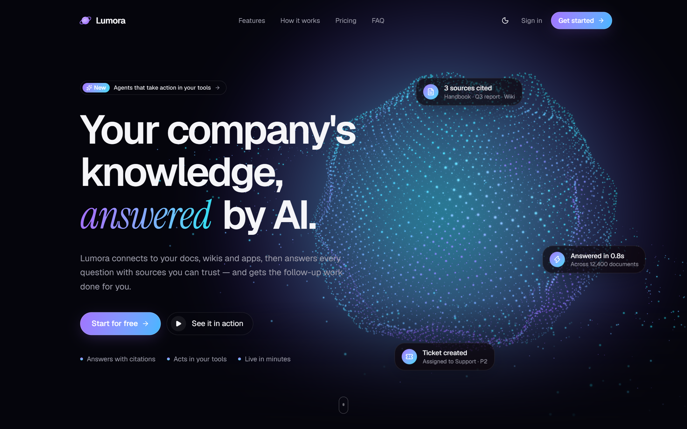
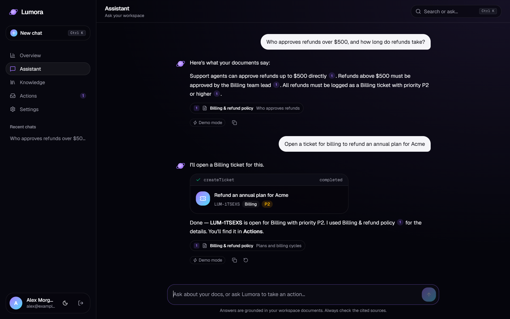
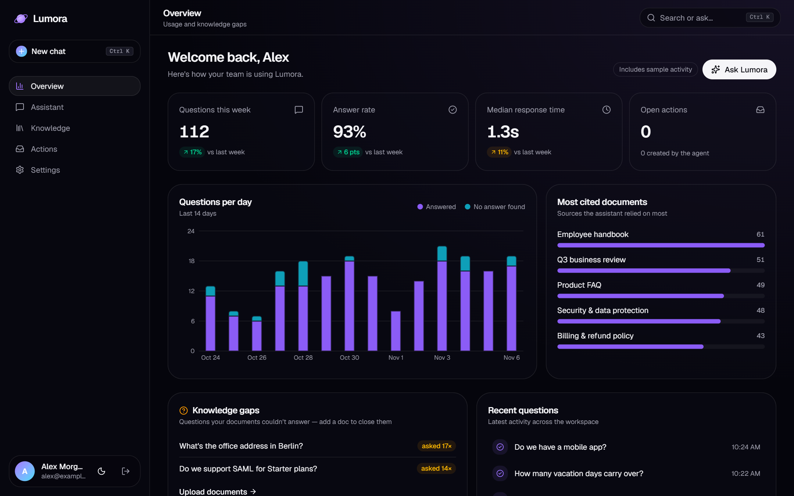
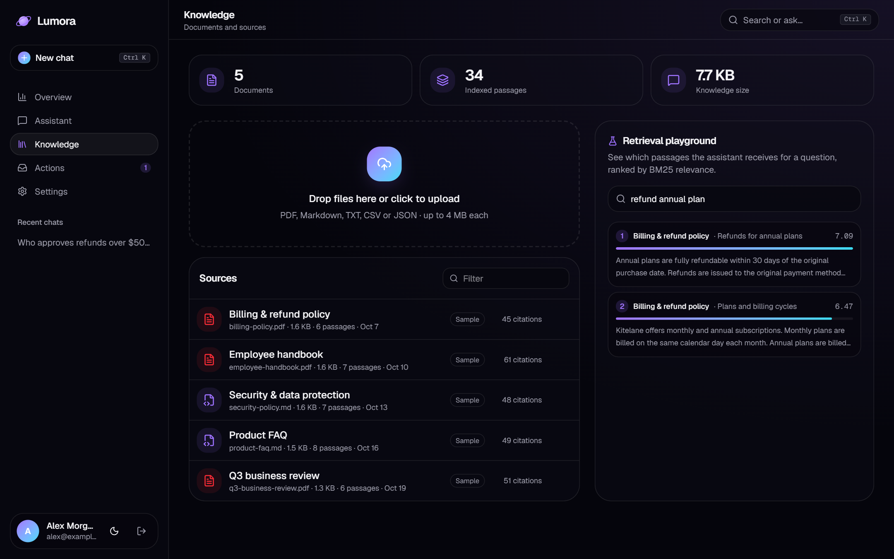
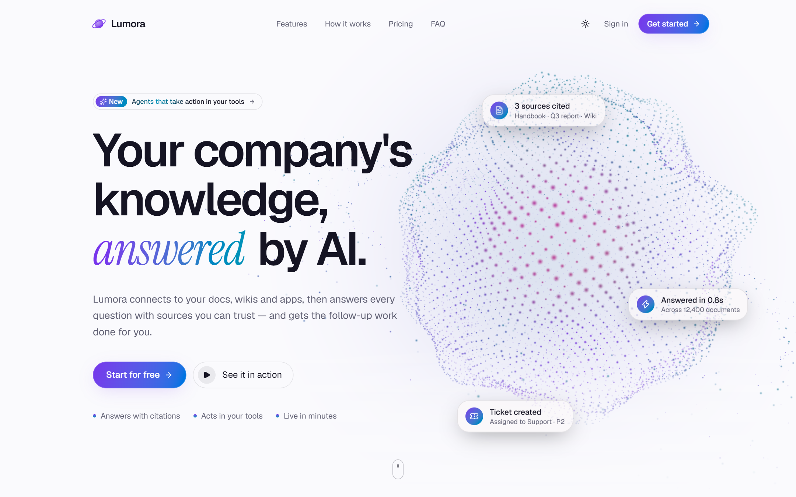
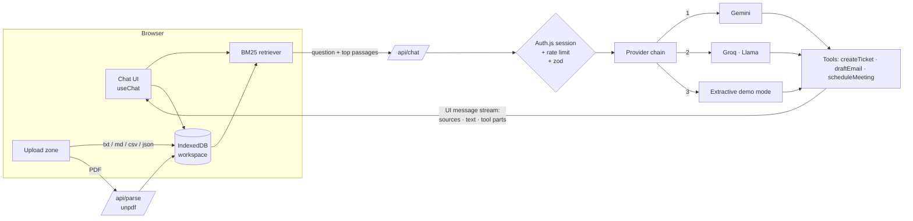

# Lumora — AI Knowledge Agent

> Your company's knowledge, answered by AI. Lumora turns documents into an assistant that answers with **citations** and takes **actions** (tickets, emails, meetings) through tool calls.

**Live demo:** [lumora-ai-agent.vercel.app](https://lumora-ai-agent.vercel.app) · **Stack:** Next.js 16 · React 19 · TypeScript · Tailwind CSS 4 · Three.js · Vercel AI SDK 7 · Gemini / Groq · Auth.js



Lumora is a portfolio product I designed and engineered end to end: brand, marketing site, 3D hero, authentication, a retrieval-augmented chat agent, document ingestion, an actions inbox and an analytics dashboard. Company names and testimonials in the demo are fictional.

---

## Highlights

| | |
|---|---|
| **RAG with real citations** | Documents are chunked by section and ranked with Okapi BM25. Every claim in an answer links to the exact passage it came from. |
| **Agentic tool calls** | The agent can `createTicket`, `draftEmail` and `scheduleMeeting`. Each call renders as a live card in the chat and lands in the Actions inbox. |
| **Provider fallback chain** | Gemini → Groq → keyless extractive mode. Each model stream is probed before anything reaches the client, so a quota error falls through to the next provider without the user noticing. |
| **Works with zero API keys** | With no model configured, Lumora still answers extractively from the retrieved passages and runs actions from intent rules, so the public demo never breaks. |
| **Custom WebGL hero** | 16k-particle sphere with GLSL simplex-noise displacement, cursor-reactive swell, an intro morph and bloom post-processing. It pauses off-screen and degrades to CSS on devices without WebGL. |
| **Production details** | Next.js 16 Cache Components and Partial Prerendering, Auth.js-protected routes via `proxy.ts`, zod-validated APIs, rate limiting (Upstash or in-memory), security headers, OG image, sitemap, reduced-motion support, dark and light themes with no flash on load. |

## Screenshots

| Assistant with citations and actions | Analytics dashboard |
|---|---|
|  |  |
| **Knowledge base and retrieval playground** | **Light theme** |
|  |  |

## Architecture



**Request lifecycle**

1. On send, the browser retrieves the six most relevant passages from the workspace index. BM25 uses an absolute score floor and a relative cut, so off-topic questions return nothing instead of misleading context.
2. `/api/chat` authenticates the user, rate-limits, validates the payload with zod, and streams a `data-sources` part first so citations can render while text is still arriving.
3. The prompt numbers the passages and instructs the model to cite them. It also says to answer "not found" rather than guess.
4. Tool results stream as typed UI parts. The client persists the conversation, records actions and logs analytics (latency, answered or not, cited documents).

## Project structure

```
src/
├─ app/
│  ├─ page.tsx                 # Marketing site
│  ├─ login/                   # Auth (demo credentials + optional GitHub)
│  ├─ app/                     # Protected workspace: overview, chat, knowledge, actions, settings
│  └─ api/                     # chat (streaming agent), parse (PDF), status, auth
├─ components/
│  ├─ three/                   # WebGL sphere: shaders.ts, sphere-rig.ts, neural-sphere.tsx
│  ├─ landing/                 # Hero, bento features, GSAP how-it-works, live demo, pricing…
│  ├─ chat/                    # Messages, markdown with citation chips, tool cards
│  └─ app/                     # Shell, sidebar, command palette (Ctrl K), workspace provider
├─ lib/
│  ├─ rag/                     # chunk.ts (section-aware chunking), bm25.ts (ranking)
│  ├─ ai/                      # tools, prompt, provider chain, keyless demo responder
│  └─ workspace/               # IndexedDB store, seed data, action extraction
├─ auth.ts                     # Auth.js config
└─ proxy.ts                    # Route protection (Next.js 16 proxy)
```

## Run locally

```bash
npm install
cp .env.example .env.local      # then set AUTH_SECRET (npx auth secret)
npm run dev                     # http://localhost:3000
```

Every AI key is optional. Add them to `.env.local` to switch on generative answers:

| Variable | Purpose | Free tier |
|---|---|---|
| `AUTH_SECRET` | Signs session cookies (**required**) | — |
| `GOOGLE_GENERATIVE_AI_API_KEY` | Gemini, the primary model | [Google AI Studio](https://aistudio.google.com/apikey) |
| `GROQ_API_KEY` | Llama via Groq, the fallback | [Groq Console](https://console.groq.com/keys) |
| `AUTH_GITHUB_ID` / `AUTH_GITHUB_SECRET` | Optional GitHub login | GitHub OAuth app |
| `UPSTASH_REDIS_REST_URL` / `_TOKEN` | Rate limiting shared across serverless instances | [Upstash](https://console.upstash.com) |

## Design decisions

- **Retrieval in the browser.** The demo keeps each visitor's workspace in IndexedDB, so it needs no database and visitors never see each other's uploads. The retriever is a plain class behind one interface, so moving it behind an API with MongoDB Atlas Vector Search or pgvector is a contained change.
- **BM25 before embeddings.** For policy-style documents, lexical ranking is fast, free and explainable. The retrieval playground shows the scores. Hybrid search with embeddings is the natural next step.
- **Three.js outside React's render cycle.** All per-frame mutation lives in a plain `SphereRig` class. React only mounts it, which satisfies the React Compiler's purity rules and keeps the frame loop allocation-free.

## Roadmap

- Hybrid retrieval (BM25 + Gemini embeddings) with re-ranking
- Server-side persistence (MongoDB Atlas) and shared team workspaces
- Real integrations for actions (Linear / Jira tickets, Gmail drafts, Google Calendar)
- Evaluation harness for answer faithfulness

---

Built by **Ahmad Sharif**, AI Engineer & Full-Stack Developer. [GitHub](https://github.com/itx-Champion)
